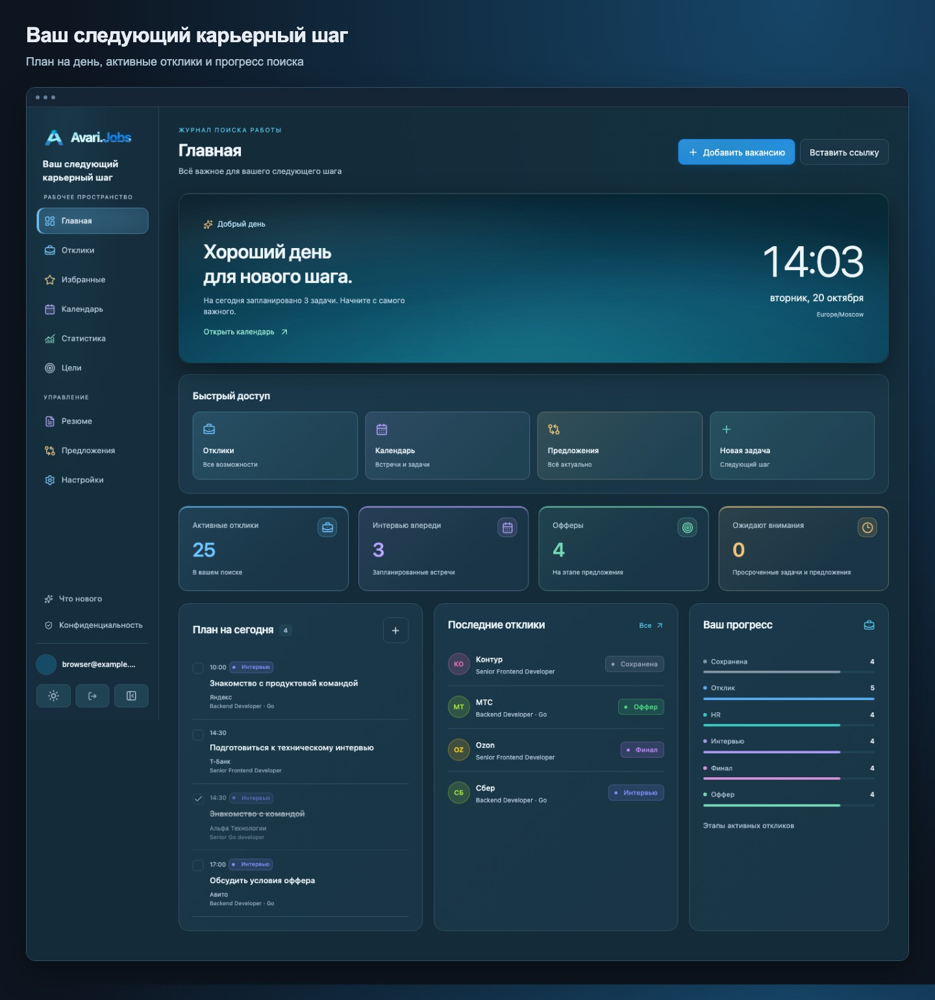
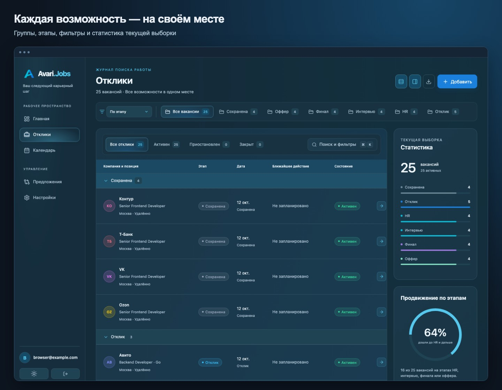
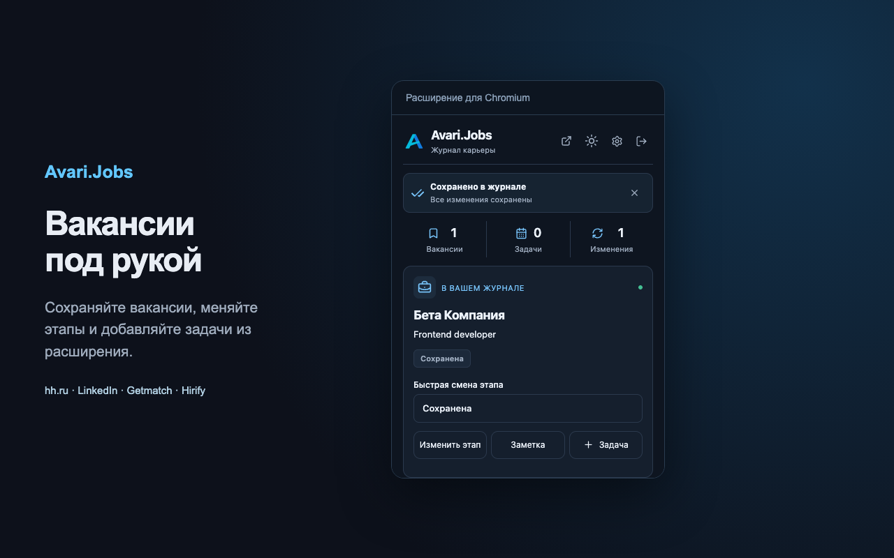
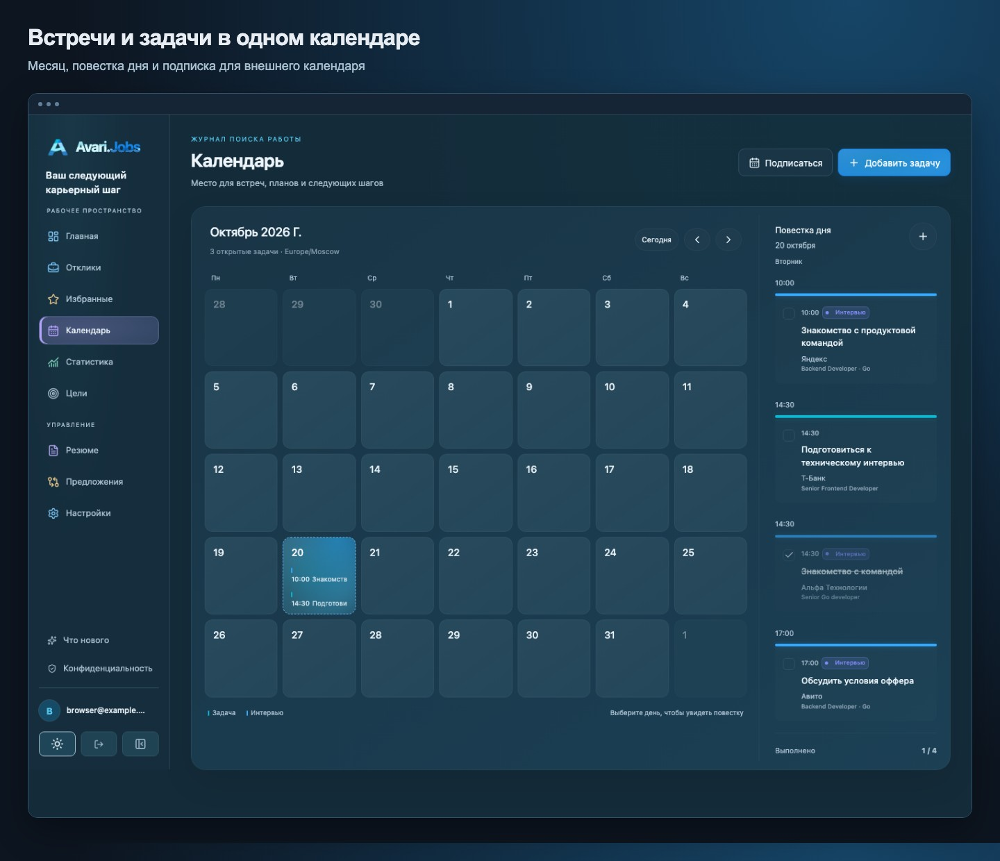
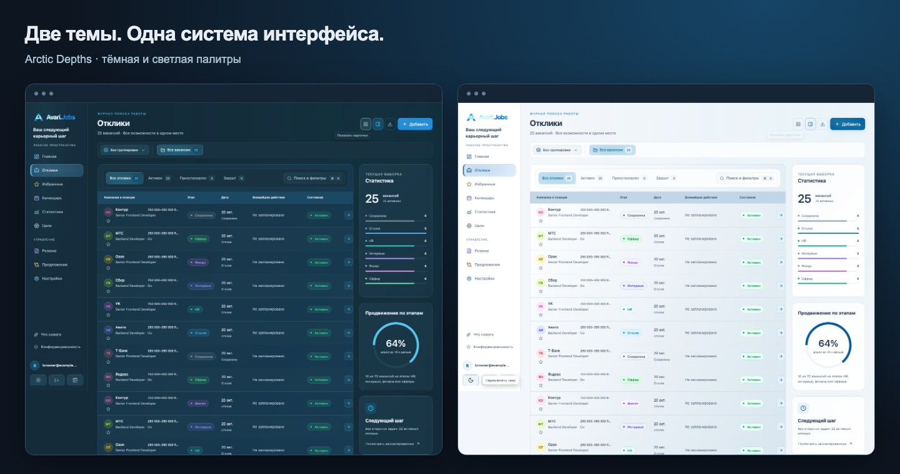
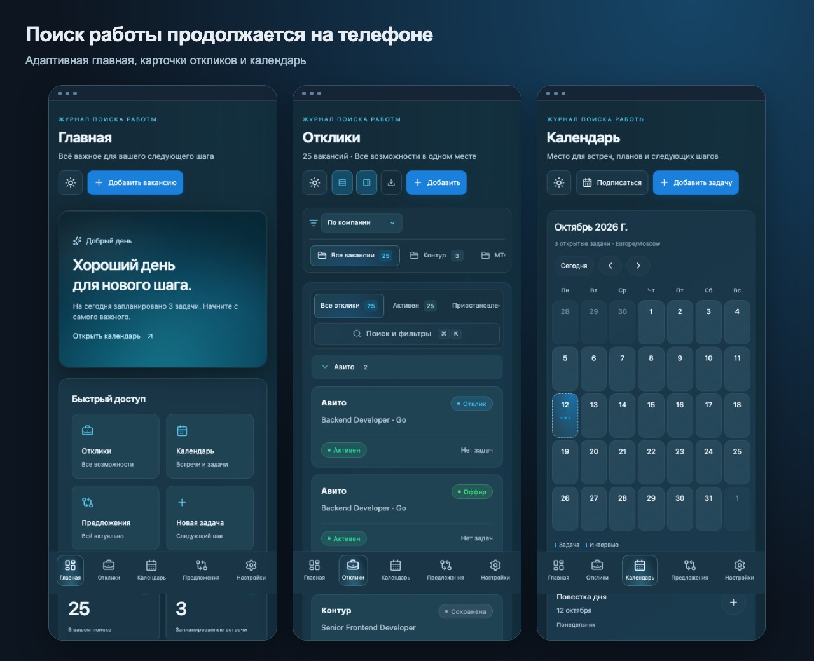

<div align="center">


# Avari.Jobs

### Ваш следующий карьерный шаг

Вакансии, отклики и интервью — в одном рабочем пространстве.<br>
Веб-приложение · Chrome extension · консольное администрирование

[](https://github.com/OstKost/avari-job-applications/actions/workflows/ci.yml)
[](LICENSE)


[Открыть приложение](https://jobs.avari.dev) · [Установить расширение](https://jobs.avari.dev/extension) · [Скачать приложение](#локальная-версия-для-windows-и-macos) · [Помощник по установке](https://ostkost.github.io/avari-job-applications/) · [Сборка из исходников](#сборка-из-исходников) · [Документация](#документация)

</div>



## От первой вакансии до оффера

Поиск работы быстро превращается в десятки вкладок, переписок и встреч. Avari.Jobs собирает этот процесс в личный журнал: сохраните интересную вакансию, отметьте отклик, запланируйте интервью и держите следующий шаг перед глазами.

Проект объединяет собственный Go API, адаптивный React-интерфейс, расширение Manifest V3 и TUI для администратора. Его можно запустить локально или развернуть на своём сервере. Интерфейс — на русском языке.

> Все изображения ниже показывают настоящий интерфейс с демонстрационными данными. Иллюстрации веб-приложения подготовлены из браузерных E2E-снимков; некоторые длинные страницы показаны фрагментами.

## Возможности

### Журнал, который подстраивается под ваш поиск

Шесть этапов помогают видеть путь каждой вакансии:

**Сохранена → Отклик → HR → Интервью → Финал → Оффер**

Состояние процесса учитывается отдельно: активный, приостановленный или закрытый. Можно сохранить интересную вакансию ещё до отклика, поставить поиск на паузу и зафиксировать результат закрытия.

- **Всё о вакансии:** компания, позиция, ссылка, зарплата, локация, формат работы, контакт рекрутера, приоритет, заметки и история изменений.
- **Своя организация:** несколько пользовательских групп для одной вакансии; группировка списка по этапу, состоянию, компании или приоритету.
- **Быстрый обзор:** поиск и фильтры, сортировка, сворачиваемые группы, плотность строк и панель статистики.
- **Собственные критерии:** до пяти дополнительных полей и до 1000 вакансий на аккаунт.
- **Выгрузка в CSV:** экспорт текущей выборки с дополнительными полями и ближайшей открытой задачей для каждой вакансии.



Статистика учитывает всю отфильтрованную выборку, а список разбит на страницы по 20 записей. Настройки отображения сохраняются в браузере отдельно для каждого аккаунта.

### Вакансия из браузера — сразу в журнал

Расширение для Chrome и Chromium читает открытую карточку на **hh.ru, LinkedIn, Getmatch и Hirify**. Компания, позиция, зарплата и другие доступные поля подставляются в форму; недостающие сведения можно дополнить вручную.



- **Popup и мини-окно на странице:** быстрое сохранение вакансии, выбор группы и смена этапа; из popup также доступны заметки и задачи.
- **Сопоставление с журналом:** ссылки нормализуются по площадке и ID вакансии, чтобы параметры перехода и суффиксы названий не создавали дублей.
- **Предложения изменений:** на поддерживаемых страницах откликов hh.ru, Getmatch и Hirify расширение сопоставляет явные статусы с журналом. Изменения проходят через подтверждение пользователя.
- **Импорт недостающих откликов hh.ru:** предложения добавить вакансии за последний календарный месяц с датой отклика из списка.
- **Сохранение черновиков:** незавершённые вакансии, задачи и заметки восстанавливаются после закрытия popup.
- **Свой сервер:** подключение к jobs.avari.dev или к собственному экземпляру Avari.Jobs.

Расширение работает с DOM открытой страницы и публичным JobPosting JSON-LD. Оно не отправляет отклики, не передаёт cookies, пароли площадок или переписку. Токен Avari.Jobs доступен только доверенным контекстам расширения; content script его не получает.

<details>
<summary><strong>Границы интеграций</strong></summary>

Парсеры зависят от разметки площадок. Расширение читает текущую страницу и её изменения; для следующих страниц списка нужно перейти на них самостоятельно. Не найденные поля остаются пустыми.

LinkedIn поддерживает карточки вакансий и загруженную карточку в поиске с совпадающим ID; `/jobs-tracker` не разбирается. Наличие вакансии не означает отправленный отклик, а отсутствие ответа или строки в списке не означает отказ. Неизвестные статусы сохраняются как наблюдение без автоматической смены этапа.

Подробности поддерживаемых URL, обработки статусов и проверок на живых страницах — в [руководстве](docs/Usage.md#расширение).

</details>

### Календарь следующего шага

Задачи и интервью связаны с вакансиями. Месячный календарь и повестка выбранного дня помогают планировать подготовку, встречи и обсуждение оффера. Главная показывает план на сегодня и то, что требует внимания.



**Подписка по ICS** позволяет видеть открытые задачи и интервью в Apple, Google и Яндекс Календаре. Лента учитывает часовой пояс аккаунта, сохраняет ID события при переносе и исключает выполненные задачи. Секретную ссылку можно сменить или отключить.

Подписка доступна для чтения; изменения вносятся в Avari.Jobs. Частоту обновления определяет внешний календарь. Для подключения сервисов нужен экземпляр приложения, доступный по HTTPS.

### Продуманный интерфейс на любом экране

Тёмная и светлая темы объединены палитрой **Arctic Depths**. На компьютере журнал отображается таблицей, на телефоне — карточками с нижней навигацией. Выбранная тема сохраняется.





## Что внутри

```text
apps/
  server/       Go API, бизнес-логика, миграции SQLite и admin TUI
  web/          React + TypeScript + Vite
  extension/    Manifest V3: popup, service worker, content scripts и парсеры
packages/
  shared/       UI, темы, API-клиент и типы из OpenAPI
scripts/        Сборка, релизы, API-генерация и материалы для демонстрации
deploy/         Docker, systemd, reverse proxy и развёртывание
tests/          Браузерные сценарии и проверки развёртывания
```

**Frontend:** React 19, TypeScript, Vite, React Router, TanStack Query и Lucide. Общий пакет компонентов, стилей и API-клиента используется сайтом и расширением.

**Backend:** Go, SQLite в режиме WAL и встроенные миграции. Собранный сайт встраивается в серверный бинарник; для обычного запуска не нужны отдельный frontend-сервер, сервер базы данных или CGO.

**Администрирование:** Bubble Tea + Lip Gloss. Через TUI администратор одобряет регистрации, блокирует пользователей, сбрасывает пароли, отзывает сессии и управляет резервными копиями.

### Инженерные решения

- **Явное подтверждение данных площадок.** Внешнее наблюдение превращается в предложение, которое пользователь может проверить, изменить или отклонить.
- **Защита от потери изменений.** При конкурентном редактировании приложение обнаруживает конфликт и предлагает загрузить актуальную версию.
- **Изоляция аккаунтов и сессий.** Пароли хешируются Argon2id; веб-запросы с изменениями защищены CSRF. Блокировка и сброс пароля отзывают все сессии. Новые регистрации требуют одобрения администратора.
- **Единый API-контракт.** TypeScript-типы генерируются из OpenAPI; CI проверяет, что контракт и сгенерированный код согласованы.
- **Восстановление данных.** Резервные копии создаются через `VACUUM INTO`; восстановление проверяет целостность и версию схемы, использует эксклюзивную блокировку и отзывает сессии.
- **Проверка полного сценария.** Playwright работает с настоящим Go-сервисом, временной SQLite и настоящим MV3-расширением в отдельном Chromium-профиле.

## Локальная версия для Windows и macOS

**Установите Avari.Jobs и запустите по иконке.** Приложение само поднимет локальный сервис и откроет журнал в браузере. Go, Node.js, Docker и терминал для этого не нужны.

- **[Скачать для Windows 10/11 x64](https://github.com/OstKost/avari-job-applications/releases/latest/download/avari-jobs-windows-x64-setup.exe)** — установщик `.exe`.
- **[Скачать для macOS 13+ · Apple Silicon](https://github.com/OstKost/avari-job-applications/releases/latest/download/avari-jobs-macos-apple-silicon.dmg)** — M1 и новее.
- **[Скачать для macOS 13+ · Intel](https://github.com/OstKost/avari-job-applications/releases/latest/download/avari-jobs-macos-intel.dmg)**.
- **[Открыть визуальный помощник по установке](https://ostkost.github.io/avari-job-applications/)** — выбор версии и четыре шага до первого сохранения вакансии.

Все файлы и контрольные суммы доступны в [последнем релизе](https://github.com/OstKost/avari-job-applications/releases/latest).

> Текущие установщики выпускаются без сертификата издателя и notarization Apple. Windows может показывать предупреждение SmartScreen, macOS — ограничивать запуск через Gatekeeper. Скачивайте файлы только из официального релиза этого репозитория. [Онлайн-версия](https://jobs.avari.dev) доступна без установки.

### После установки

1. Запустите Avari.Jobs. Мастер проверит локальный сервис и предложит создать личный аккаунт без одобрения через TUI.
2. При желании включите автозапуск. Его легко отключить в **Настройки → Общие → Локальный Avari.Jobs**.
3. Установите расширение [из магазина, когда публикация доступна](https://jobs.avari.dev/extension), либо [скачайте архив для ручной установки](https://github.com/OstKost/avari-job-applications/releases/latest/download/avari-extension.zip) и загрузите распакованную папку через режим разработчика. Оба варианта сохраняются.
4. В расширении выберите «Локальное сохранение» и войдите с локальным аккаунтом. Адрес `http://127.0.0.1:47831` уже указан; если вы меняли порт в мастере, обновите его в «Настройках адресов».

Закрытие браузера не останавливает сервис. Открытие журнала, перезапуск и завершение доступны через значок в трее Windows или строке меню macOS. Данные хранятся на этом компьютере и сохраняются при обновлении приложения. Новые версии предлагаются в интерфейсе; скачивание и установка с перезапуском запускаются по вашей команде в настройках. Раздел «Что нового» доступен в локальной и онлайн-версии.

**Импорт и экспорт:** в настройках локальной и онлайн-версии доступен полный JSON-журнал. Импорт дополняет данные, сохраняет текущие версии записей и не создаёт дубли при повторной загрузке. Автоматической синхронизации с продакшеном нет.

Подробнее: [руководство локальной версии](docs/Local-Version.md). Linux пока использует серверные архивы и Docker.

## Сборка из исходников

Нужны **Go 1.27.1+**, **Node.js 22.12+**, npm и `make`.

```sh
git clone https://github.com/OstKost/avari-job-applications.git
cd avari-job-applications
npm ci
make build
./bin/avari
```

Откройте **http://localhost:47831** и зарегистрируйтесь. Затем в другом терминале запустите:

```sh
./bin/avari-admin
```

Выберите заявку на регистрацию, нажмите `a` и подтвердите Enter. Страница ожидания обновится автоматически. Отдельный веб-аккаунт администратора не требуется: TUI работает через локальные права ОС.

### Подключить расширение

1. Откройте `chrome://extensions` и включите режим разработчика.
2. Нажмите **«Загрузить распакованное расширение»** и выберите `apps/extension/dist`.
3. Выберите в расширении «Локальное сохранение» и войдите. Авторизация расширения отдельная от сайта.
4. Откройте поддерживаемую вакансию и сохраните её через popup или **«Открыть мини-окно на странице»**.

Архив создаётся в `dist/avari-extension.zip`. Для рабочего сервера доступны [страница расширения](https://jobs.avari.dev/extension), установка из Chrome Web Store и скачивание персонального архива в настройках личного кабинета. Production-релиз подключается к jobs.avari.dev по умолчанию; локальный режим выбирается через **«Локальное сохранение»**, а адреса меняются в **«Настройках адресов»**.

### Разработка

После первой сборки запустите API и Vite в двух терминалах:

```sh
AVARI_ORIGIN=http://localhost:5173 make api
```

```sh
make dev
```

Интерфейс откроется на **http://localhost:5173**; Vite проксирует `/api` на Go-сервис. Для сборки расширения в watch-режиме используйте `make dev-ext`.

### Docker и свой сервер

```sh
make build
docker compose up --build -d app
# Одобрение регистраций через TUI:
docker compose run --rm admin
```

Приложение доступно на **http://localhost:47831**. SQLite и резервные копии сохраняются в томе `avari-data`. Для публичного сервера предусмотрены Caddy с HTTPS, systemd и вариант установки за существующим reverse proxy.

Инструкции: [Docker и конфигурация](docs/Usage.md#docker) · [развёртывание на VPS](deploy/README.md).

## Проверки и релизы

```sh
make build test                    # Сборка, TypeScript, Vitest, Go race tests и vet
npx playwright install chromium
make e2e                           # Браузерные сценарии сайта и расширения
make release                       # Linux amd64/arm64 и архив расширения
```

CI также проверяет развёртывание, сборку Docker-образа и актуальность API-типов. Тесты покрывают изоляцию пользователей, сессии, лимиты, конкурентные изменения, предложения, календарную подписку и восстановление базы. Парсеры площадок проверяются на обезличенных DOM-примерах; они требуют периодической проверки на живых страницах.

Чтобы обновить изображения README после E2E-проверок:

```sh
node scripts/readme-media.mjs
```

## Документация

- [Визуальный помощник](https://ostkost.github.io/avari-job-applications/) — установка Windows/macOS, расширение и первые шаги.
- [Локальная версия](docs/Local-Version.md) — запуск, автозапуск, импорт/экспорт и сборка установщиков.

- [Руководство пользователя и администратора](docs/Usage.md) — подробности функций, календарной подписки, конфигурации, TUI и резервных копий.
- [Развёртывание и обновления](deploy/README.md) — production-инфраструктура и GitHub Actions.
- [OpenAPI](docs/openapi.json) — контракт API; обновление типов: `npm run generate:api`.
- [Chrome Web Store](docs/Chrome-Web-Store.md) — материалы, разрешения и процесс публикации.
- [PRD](docs/01-PRD.md) и [спецификация интерфейса](docs/02-UI-Specification.md) — исходные продуктовые и дизайнерские требования; реализованное поведение описано в руководстве.

## Лицензия

[MIT](LICENSE) · [OstKost](https://github.com/OstKost)
